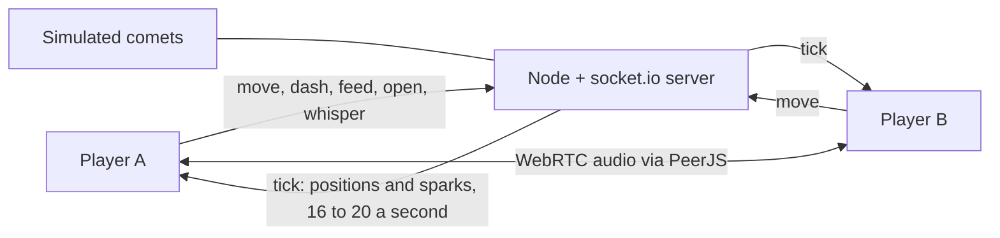

# Whispiverse

A forum you fly through. Every player is a comet in a shared 3D sky, every conversation is a topic that floats in it, and a topic only stays open while people keep feeding it.

## Why I built it

This is a 2022 WebXR and 3D experiment. I wanted a shared space that was social first: you hear the people near you, and what you leave behind fades unless others care enough to keep it going.

## What it does

- You fly a comet through a shared Three.js sky, steering with the mouse
- Sparks drift through the sky and fall toward any comet that comes near
- Five sparks open a topic: a star with a name, a line about it and a picture
- A topic has a zone around it. Inside the zone you can talk, by text and by voice, and nobody can hit you
- A topic loses a second of time every second. One spark buys it 15 more
- Fed enough, a topic gains a level and can hold more time
- In open sky a comet can dash into another and scatter the sparks it carries
- A map shows the whole sky from far off with every open topic named, and guides you to the one you pick
- Simulated comets, labelled as such, keep the sky busy when few people are in it

## How it works

One Node process owns the world and serves the client. The browser draws what the server says, flies its own comet, and reports where it is.



### The server owns everything that can be argued about

Positions, sparks, scores, topics and hits are decided in `server/index.js`. A client only says where it is and what it wants to do. Sparks are a fixed set of 80 that drift, get pulled toward the nearest comet within 15 units, and reappear elsewhere when taken, so their number never changes. When a comet is scattered, the sparks it drops are that many of the sky's own sparks moved to where it was.

### Smooth motion from a slow clock

The server steps about 16 times a second on Windows and 20 elsewhere, and moves everything by the time that really passed. The first version sent positions as droppable packets and the client chased the newest one: about 30% were lost and comets lurched. Now every step is sent in order, and the client slides each comet along the line between the last two arrivals, timed by how far apart arrivals have been.

### An economy with one sink

Sparks are only good for topics. What you carry is written under your comet, so a loaded comet is a known target, and it is lost if you are hit. What you spend is counted for good as "given", which nobody can take. That leaves one sensible thing to do with sparks: carry them to a topic and spend them there.

### Talk belongs to a place

A whisper is only accepted inside a topic's zone, goes to everyone in that zone, and is kept in the topic's thread for whoever arrives later. Voice is peer to peer over PeerJS and never passes through the server; the client sets each voice's volume from whether its comet shares your topic and how near it is.

### Simulated comets

`server/sims.js` flies comets that play by the same rules as a person. Each has a role that changes with its situation: host, wanderer, keeper, hunter, guardian. A hunted one runs for a topic or turns and dashes back. In topics they take turns to speak, greet a person coming in, and answer one who says something. Everyone is told who a hunter is after, so the one being hunted sees it coming.

## Tech stack

- Client: React 18, Three.js 0.133, Vite
- Server: Node, socket.io
- Voice: PeerJS (WebRTC)

## Running it

```bash
npm install
npm run build
npm start          # http://localhost:4100
```

For development, run `npm run server` and `npm run dev` in two terminals. Vite serves the client with hot reload on port 5180 and passes the socket through to the server.

Environment: `PORT` (4100), `BOTS` (14 simulated comets, 0 for none). Voice is off until you turn it on, since it needs the microphone.

## Status

The original 2022 client talked to a companion server on Heroku whose code was never in this repo and which is offline. This version has its own server and runs on one machine. It keeps the original idea, music and sky. State is in memory: restarting the server clears topics and scores. Voice has only been exercised between two browsers on one network.
